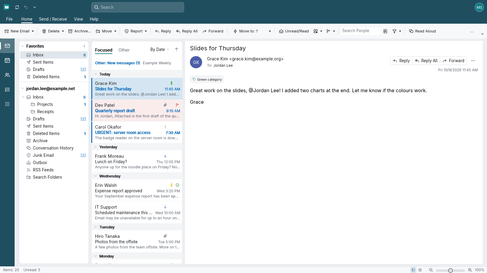
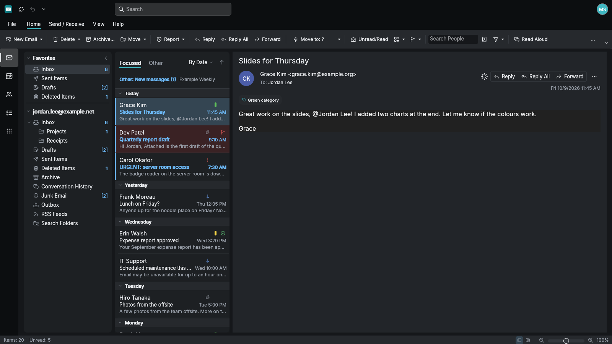
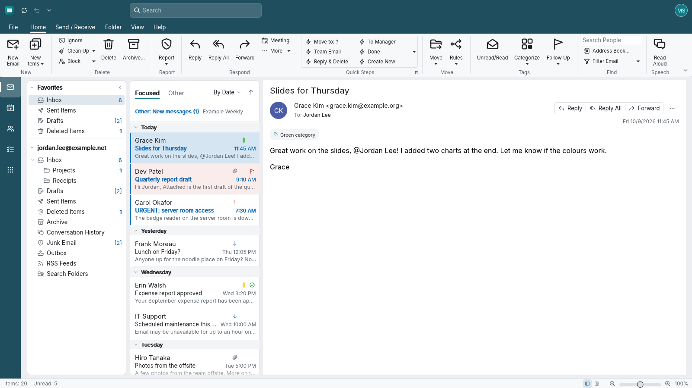
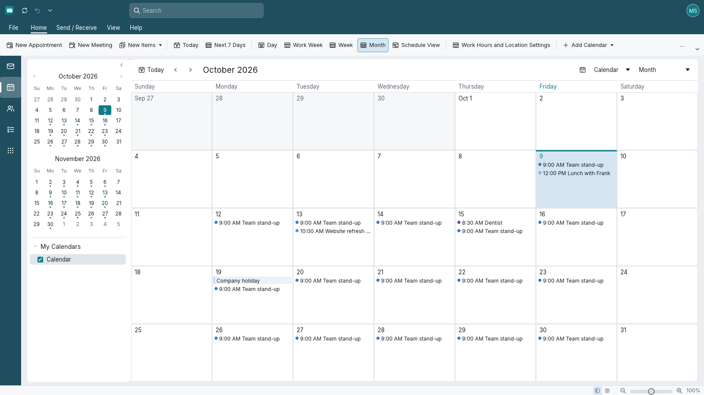
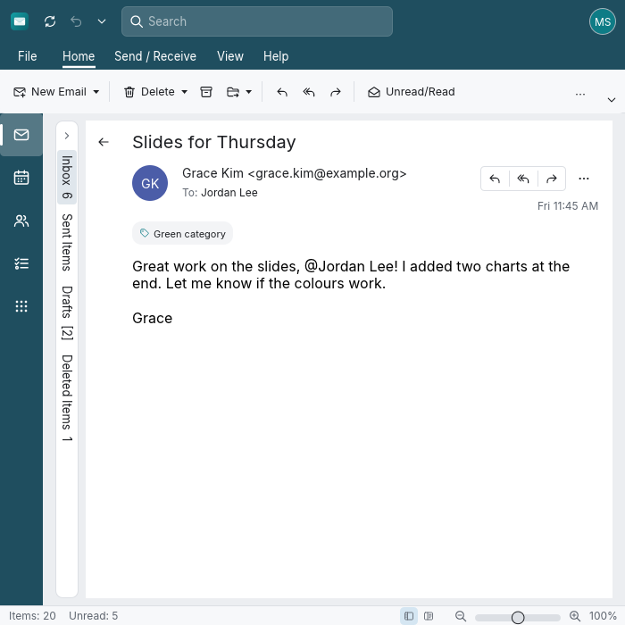

<h1 align="center">MailCraft</h1>

<p align="center">
  
</p>

<p align="center">
  <b>A clean-room, open-source desktop mail client in pure Rust, modelled on the classic Outlook workflow.</b>
</p>

<p align="center">
  Module rail, ribbon, folder pane, message list and reading pane, the way you already work: rules, quick
  steps, conversations, search folders, calendar, people, tasks and notes. IMAP and SMTP accounts with
  offline sync. Runs natively on Linux, Windows, macOS and FreeBSD, and in the browser via WebAssembly.
</p>

<p align="center">
  <a href="#a-tour">A tour</a> ·
  <a href="#what-works-today">What works today</a> ·
  <a href="#quick-start">Quick start</a> ·
  <a href="#for-agents-cli-and-mcp">For agents</a> ·
  <a href="#architecture">Architecture</a> ·
  <a href="#roadmap">Roadmap</a> ·
  <a href="#license">License</a>
</p>

<p align="center">
  
  <br><sub>The sample mailbox: folder pane with unread and [total] counts, date groups, unread bars, flags and categories, and the reading pane.</sub>
</p>

## A tour

| | |
|---|---|
|  |  |
| Dark theme | Classic ribbon (Simplified is the default) |
|  |  |
| Calendar | Narrow windows: the folder pane minimises and the list and reading pane take turns |

## Why MailCraft

- **The workflow you know.** Behaviour, layout and feature names follow careful black-box observation of the
  classic desktop client: default folder order, unread and total badges, date groups, RE:/FW: handling, the
  quoted header on replies, the Rules Wizard, ribbon degradation as the window narrows.
- **Yours.** Open source (MIT OR Apache-2.0), local-first storage, standard protocols (IMAP, SMTP, JMAP) and
  standard files (EML, MBOX, MSG, iCalendar, vCard, CSV). No telemetry.
- **Agent-drivable.** Every action is a named command. The CLI, the JSON control channel and the MCP server
  drive the same commands the ribbon does.
- **Never crash.** No panics in non-test code, hostile-input fuzzing over every command, size caps on every
  parser.

## What works today

Status: **pre-alpha**. See [ROADMAP.md](ROADMAP.md) for honest per-area estimates and
[docs/parity.md](docs/parity.md) for the feature catalog. Account types, push, POP3, JMAP, OAuth sign-in and
where passwords are kept: [docs/accounts.md](docs/accounts.md).

- **Mail:** read, reply, reply all, forward (inline or in a window), drafts, delete/archive/move/copy,
  flags, categories, importance, Focused/Other, arrange by 13 keys, filters, conversations, search with a
  query language, search folders.
- **Compose:** rich text, spelling with suggestions, signatures, address auto-complete, attachments.
- **Accounts:** IMAP + SMTP with background sync, an offline queue, Outbox → Sent, Send/Receive.
- **Organise:** rules (Rules Wizard, run on arrival or on demand), quick steps, colour categories.
- **Calendar, People, To Do, Notes:** views, editors, meeting requests over iCalendar, reminders.
- **Files:** import and export EML, MBOX, MSG, ICS, VCF, CSV; print and PDF.

## Quick start

Packages for Linux, Windows, macOS, FreeBSD and the web are published on the
[releases page](https://github.com/MonkeySaint/mailcraft/releases) (see [docs/releasing.md](docs/releasing.md)).
To build from source:

```sh
git clone https://github.com/MonkeySaint/mailcraft.git && cd mailcraft

# Desktop app with the built-in sample mailbox
cargo run --release -p mailcraft -- --sample

# Your own local profile (data in ~/.local/share/MailCraft by default)
cargo run --release -p mailcraft

# Local test mail servers for trying accounts without a real mailbox
cargo run -p mailcraft-testmail-app -- --help
```

Web build: see [apps/mailcraft-web/README.md](apps/mailcraft-web/README.md).

## For agents: CLI and MCP

```sh
mailcraft-cli commands                 # every command id, label, location, shortcut
mailcraft-cli parity                   # catalog coverage summary
mailcraft-cli run --sample --cmd 'mail.reply' --query list
mailcraft-cli mcp --sample             # MCP server over stdio (see docs/mcp.md)
```

A running app can be driven over a local JSON control channel (`--control-port N`, see
[docs/control-protocol.md](docs/control-protocol.md)); `mailcraft-cli mcp --connect 127.0.0.1:N` bridges MCP to it.

## Architecture

| Layer | Crates | Job |
|---|---|---|
| L0 | `geom`, `mime` | units and colours; RFC 5322 and MIME parse/build |
| L1 | `model`, `fonts` | mailbox model, rich text, dates; bundled open fonts |
| L2 | `store`, `html`, `layout` | local storage; HTML sanitising ↔ rich text; body layout |
| L3 | `render`, `net`, `formats`, `proof`, `search` | rasteriser and PDF; IMAP/SMTP/JMAP/OAuth2; file formats; spelling; search |
| L4 | `engine` | session, undo, command registry, feature catalog, sync |
| L5 | `mcp` | MCP server |
| L6 | `ui-egui` | the Outlook-style user interface |
| apps | `mailcraft`, `mailcraft-cli`, `mailcraft-web`, `mailcraft-testmail-app` | binaries |

`cargo xtask ci` runs fmt, clippy, tests, the layer check, asset attribution, the licence allowlist, the parity
floor and the wasm build. CI runs on GitHub Actions (`.github/workflows/`).

## Roadmap

[ROADMAP.md](ROADMAP.md) lists milestones, honest parity per area and what needs the project owner. Bugs and
ideas go to the [issue tracker](https://github.com/MonkeySaint/mailcraft/issues).

## License

MIT OR Apache-2.0, at your option ([LICENSE-MIT](LICENSE-MIT), [LICENSE-APACHE](LICENSE-APACHE)). Bundled fonts
are under the SIL Open Font License; see [NOTICE](NOTICE) and [ATTRIBUTION.md](ATTRIBUTION.md).

MailCraft is an independent project, not affiliated with or endorsed by Microsoft. Outlook is a trademark of
Microsoft Corporation, used here only to describe the workflow MailCraft is modelled on.
